<div align="center">


# Loadmill Demo Shop

**A tiny, fully offline Android store built to be tested by AI agents.**

The built-in practice app for [Droid](https://github.com/loadmill/droid-cua), Loadmill's AI mobile-testing agent.<br>
Run your first test before you upload an app of your own.


</div>

The screenshots below show the original catalog before the merch refresh; the purchase flow is unchanged.

<table align="center">
  <tr>
    <td align="center">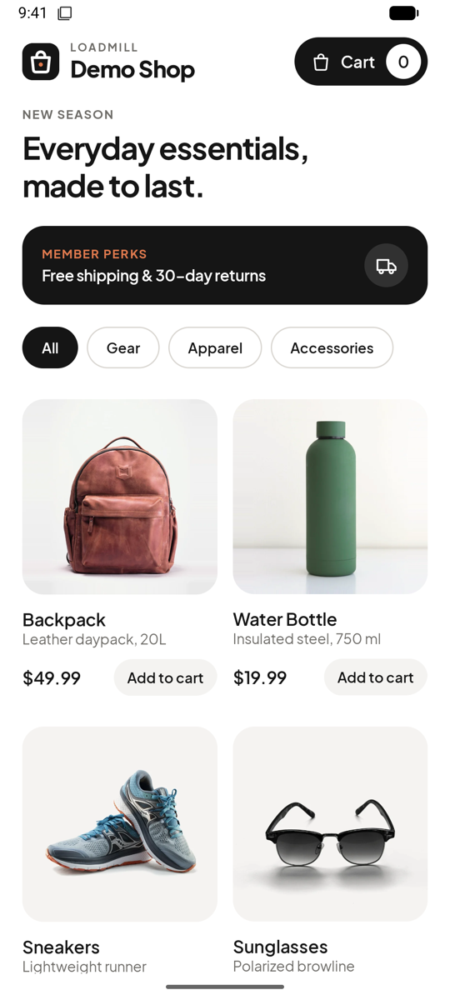</td>
    <td align="center">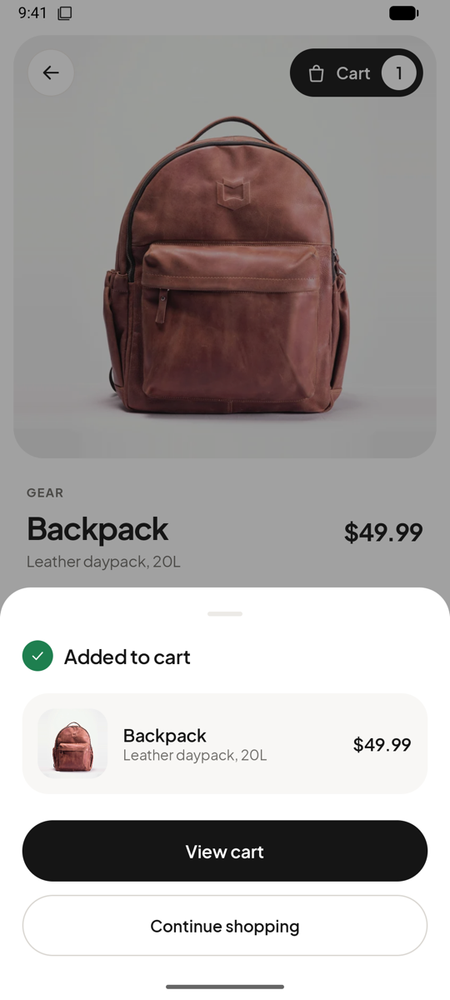</td>
    <td align="center">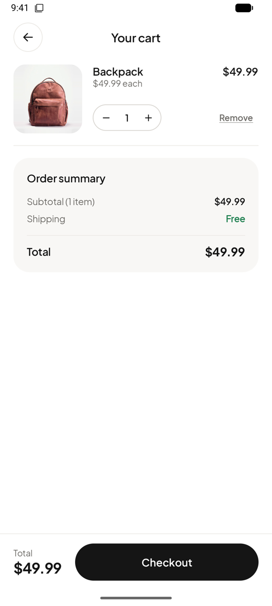</td>
    <td align="center">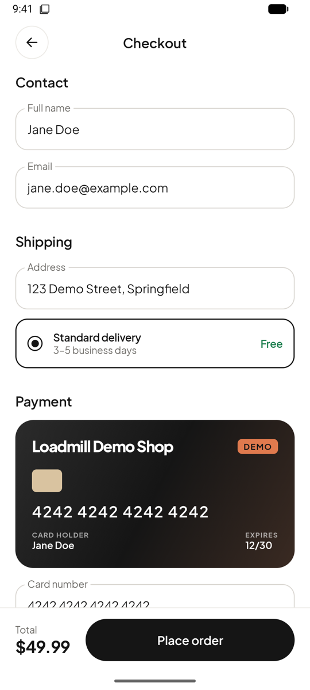</td>
    <td align="center">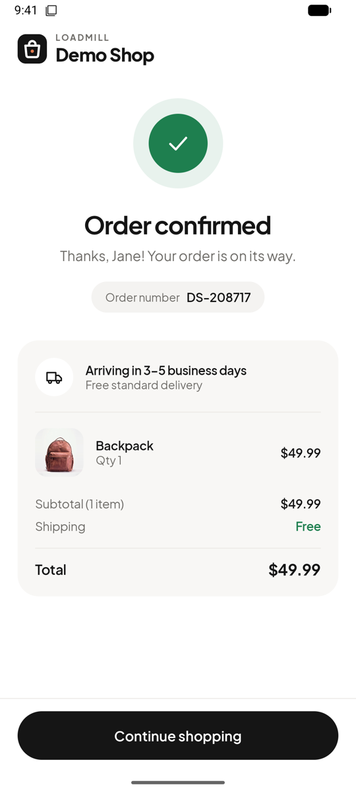</td>
  </tr>
  <tr>
    <td align="center"><sub><b>Catalog</b></sub></td>
    <td align="center"><sub><b>Added to cart</b></sub></td>
    <td align="center"><sub><b>Cart</b></sub></td>
    <td align="center"><sub><b>Checkout</b></sub></td>
    <td align="center"><sub><b>Confirmed</b></sub></td>
  </tr>
</table>

## Why it exists

A first test with a mobile-testing agent shouldn't depend on finding a build, a test account and a stable backend. Demo Shop is a small store that behaves the same way on every run:

- **Six Loadmill merch products with generated product imagery** across three categories
- **A complete purchase flow**: catalog, product page, cart, checkout, confirmation
- **No network, no persistence, no payments**: there's no `INTERNET` permission, the cart lives in memory, and the card is a demo card
- **A monochrome, editorial look** in Plus Jakarta Sans, light theme, edge-to-edge

## The merch collection

Captured from the Android app:

<table><tr>
<td>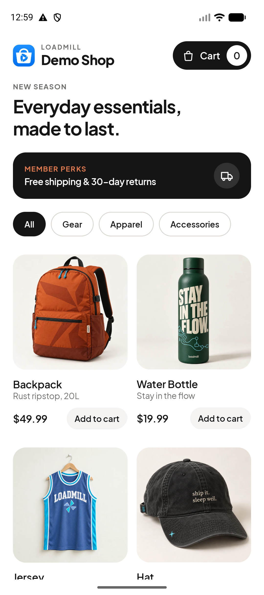</td>
<td>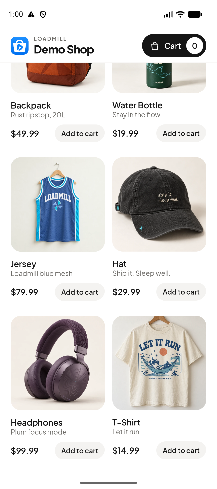</td>
<td>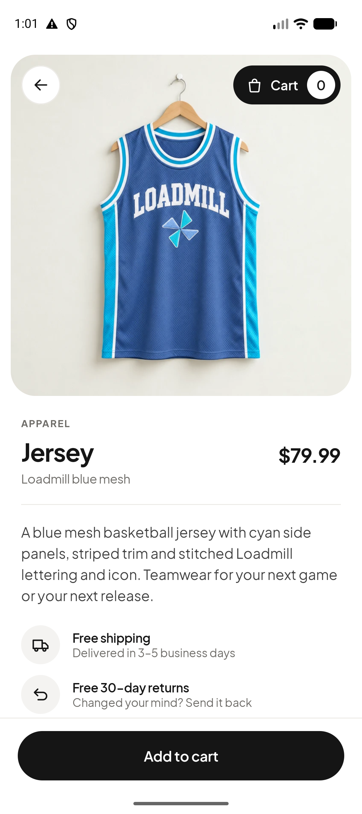</td>
</tr></table>

| Product | Color | Design | Preview |
| --- | --- | --- | --- |
| Backpack | Rust orange | Tonal windmill pattern and woven label | 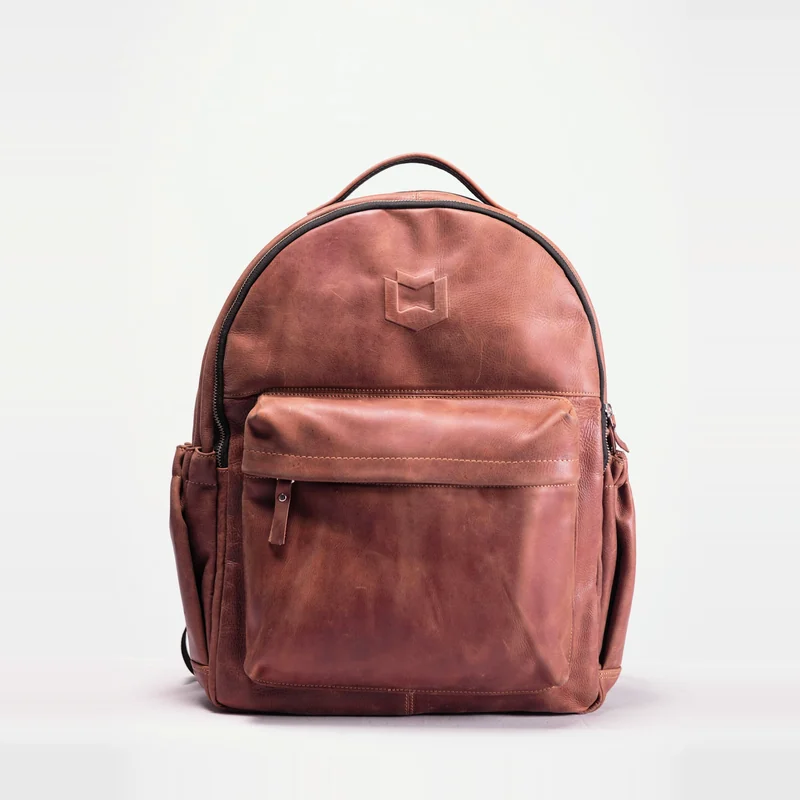 |
| Water Bottle | Forest green | Stay in the Flow lettering and flowchart illustration | 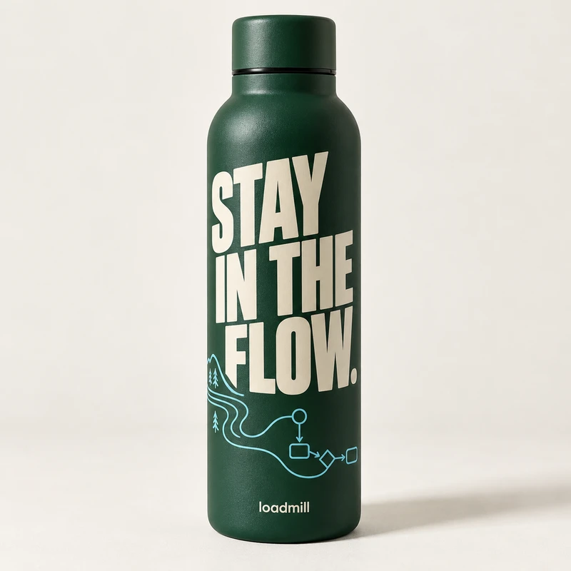 |
| Jersey | Blue | Loadmill basketball teamwear with cyan trim | 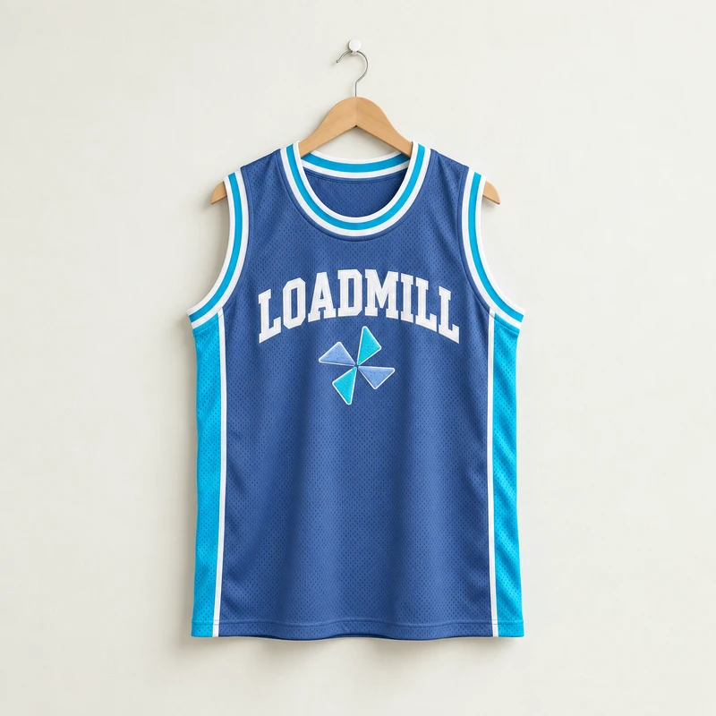 |
| Hat | Washed black | Ship it. Sleep well. embroidery | 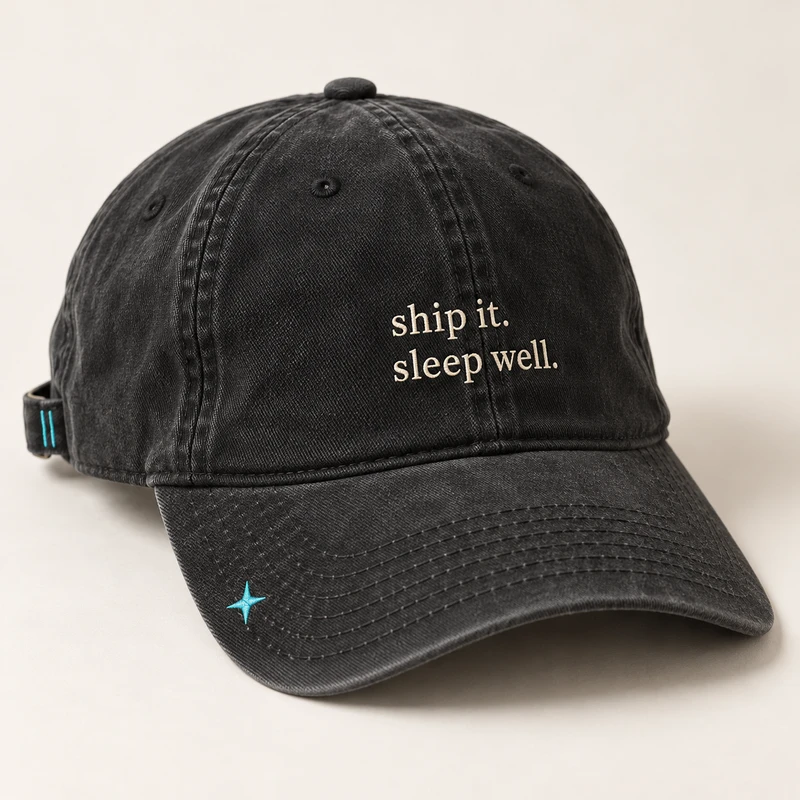 |
| Headphones | Plum purple | Ripple texture and subtle engraving | 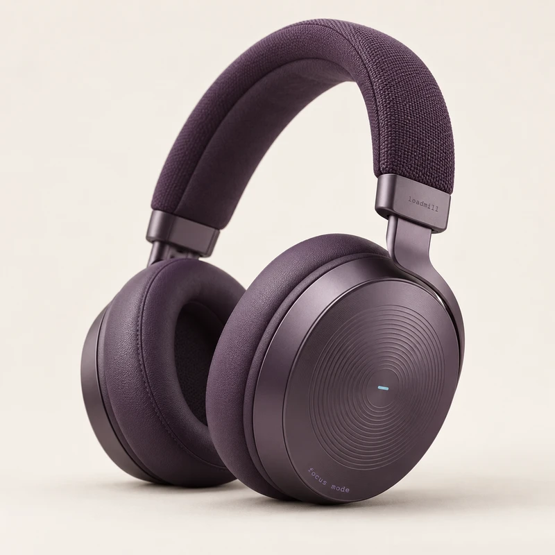 |
| T-Shirt | Cream | Let It Run robot illustration | 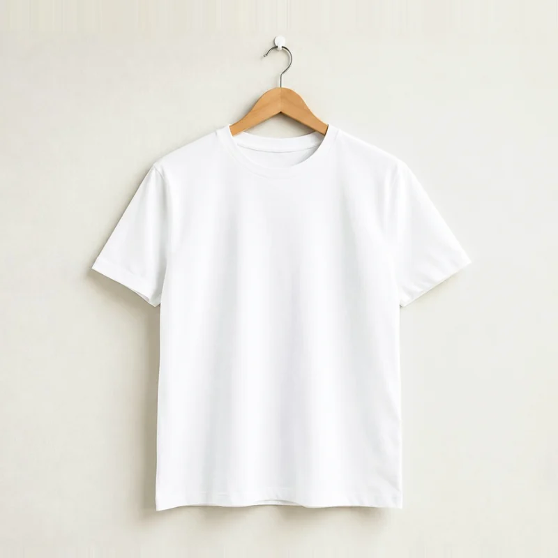 |

The jersey replaces Sneakers and the hat replaces Sunglasses. Product prices, categories and the purchase flow stay the same. These are fictional demo products.

## The demo journey

The happy path most first tests cover:

```
Backpack  →  Add to cart  →  View cart  →  Checkout  →  Place order  →  Continue shopping
```

| Step | Screen | What you'll see |
| --- | --- | --- |
| 1 | **Catalog** | The **Loadmill Demo Shop** wordmark, a **Cart 0** button, category chips (**All**, **Gear**, **Apparel**, **Accessories**) and a two-column grid with **Backpack** first. Tapping a card opens its product page; the card's compact **Add to cart** button adds it without leaving the catalog. |
| 2 | **Product page** | Photo, price, description and **Add to cart**. Tapping it opens an **Added to cart** sheet with **View cart** and **Continue shopping**. Dismissing the sheet keeps you on the product page, which then shows "1 in your cart". |
| 3 | **Your cart** | Line items with a **-** / **+** stepper and **Remove**, plus an order summary with **Free** shipping. **Checkout** is disabled while the cart is empty. |
| 4 | **Checkout** | **Contact**, **Shipping** and **Payment** sections, already filled in. Tap **Place order**. If a field was cleared, it's flagged **Required** and "Please fill in all fields." appears. |
| 5 | **Order confirmed** | A success check, an order number like `DS-208717`, the items and the total. **Continue shopping** clears the cart and returns to the catalog. |

### Built to be easy to test

- **Pre-filled checkout.** Jane Doe, `jane.doe@example.com`, `123 Demo Street, Springfield`, card `4242 4242 4242 4242`, expiry `12/30`, CVC `123`. No typing needed.
- **Recognizable order numbers.** Always `DS-` followed by six digits, so there's something concrete to assert on.
- **Visible text on every action.** Buttons say what they do (**Add to cart**, **View cart**, **Checkout**, **Place order**), so an agent can find them by text.
- **Nothing moves on its own.** Transitions and feedback animations finish within 300 ms; nothing loops or auto-advances.
- **A clean slate on every launch.** State is held in memory only, so a fresh launch starts on the catalog with an empty cart.

## Build it

You'll need JDK 17+ (Android Studio's bundled JBR works) and an Android SDK with platform 36. Point Gradle at the SDK with `local.properties` (`sdk.dir=/path/to/Android/sdk`) or `ANDROID_HOME`.

```sh
./gradlew installDebug          # build and install on a connected device or emulator
./gradlew assembleDebug         # app/build/outputs/apk/debug/app-debug.apk
./gradlew assembleRelease       # app/build/outputs/apk/release/
./gradlew testDebugUnitTest     # unit tests for the cart, catalog and screen flow
```

Then launch it:

```sh
adb shell am start -n com.loadmill.demoshop/.MainActivity
```

### Release signing

The release build is signed only when **all four** of these Gradle properties are set. Put them in `~/.gradle/gradle.properties`, never in this repo:

```properties
DEMO_SHOP_KEYSTORE_FILE=/absolute/path/to/demo-shop.jks
DEMO_SHOP_KEYSTORE_PASSWORD=...
DEMO_SHOP_KEY_ALIAS=...
DEMO_SHOP_KEY_PASSWORD=...
```

| Properties | `assembleRelease` output |
| --- | --- |
| All four set | `app/build/outputs/apk/release/app-release.apk` (signed) |
| Any missing or blank | `app/build/outputs/apk/release/app-release-unsigned.apk` (the build still succeeds) |

`*.jks` and `*.keystore` files are gitignored.

## At a glance

| | |
| --- | --- |
| Application ID | `com.loadmill.demoshop` |
| Launcher label | Demo Shop |
| Version | 1.0.1 (versionCode 2) |
| SDK | minSdk 26, targetSdk 36, compileSdk 36.1 |
| Stack | Kotlin 2.4, Jetpack Compose (Material 3), AndroidX ViewModel, AGP 9.4 |
| Tests | JUnit 4 |

## Project structure

```
app/src/
├── main/
│   ├── java/com/loadmill/demoshop/
│   │   ├── MainActivity.kt        # entry point
│   │   ├── ShopViewModel.kt       # current screen, cart, checkout form, order
│   │   ├── Cart.kt                # immutable cart model
│   │   ├── Product.kt             # the six products and price formatting
│   │   └── ui/                    # one file per screen, plus theme and shared components
│   └── res/
│       ├── drawable-nodpi/        # product images (800×800 WebP), Droid mark and logo tile (PNG)
│       ├── drawable/              # launcher icon layers and UI icons (vector)
│       └── font/                  # Plus Jakarta Sans
└── test/java/com/loadmill/demoshop/
    └── CartTest.kt
```

## Credits

Product imagery was generated with OpenAI image generation for this fictional Loadmill merch collection. The typeface is [Plus Jakarta Sans](https://github.com/tokotype/PlusJakartaSans) under the SIL Open Font License. Full attributions are in [`CREDITS.md`](CREDITS.md); the font license is in [`FONT-LICENSE-OFL.txt`](FONT-LICENSE-OFL.txt).

<div align="center"><sub>The products and the store aren't real. The tests you run against it are.</sub></div>
